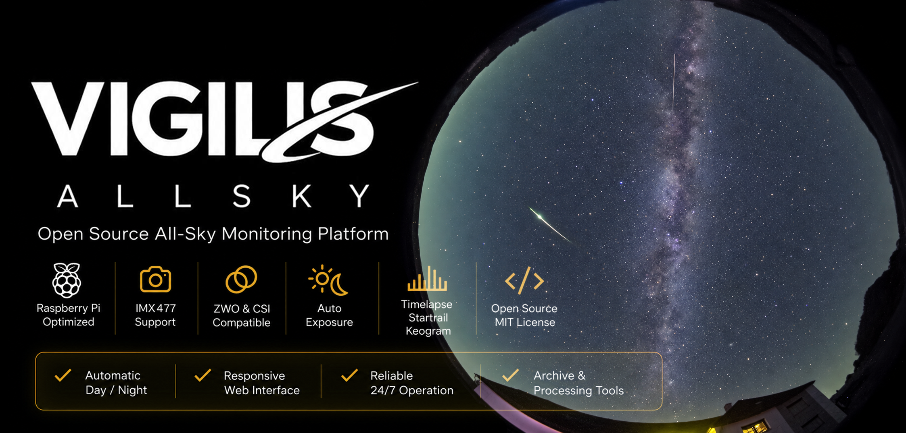
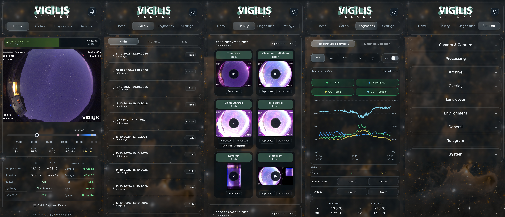
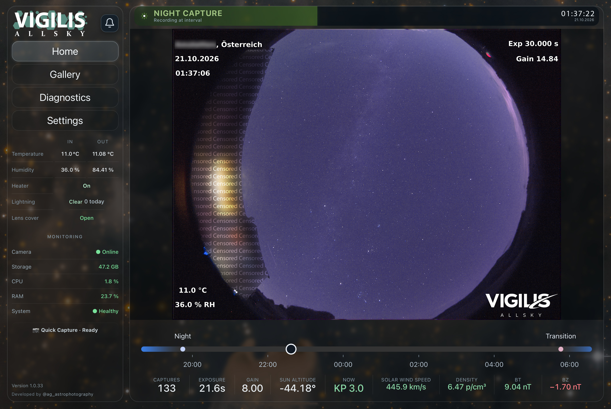

# VIGILIS AllSky

**Open-source Raspberry Pi AllSky monitoring platform for automated sky imaging, environmental monitoring, and advanced night-sky processing.**

### 📥 Download

**[Download the Latest Stable Release](https://github.com/1alex-vag/Vigilis-Allsky/releases/latest)**

The latest stable release is automatically displayed above. Download the current Raspberry Pi package from GitHub.

---

## 🌌 Overview

VIGILIS AllSky is an open-source, self-contained AllSky camera and environmental monitoring platform developed for Raspberry Pi systems.

Designed for continuous, unattended operation, VIGILIS combines automated sky imaging, adaptive exposure control, environmental monitoring, hardware automation, and advanced night-sky processing in a single responsive web interface.

The platform supports Raspberry Pi CSI cameras and selected ZWO astronomy cameras.

VIGILIS is designed for amateur astronomers, astrophotographers, and sky-monitoring enthusiasts who want a flexible, automated, and locally controlled observing station.

---

## ✨ Key Features

### Camera & Capture

- Raspberry Pi optimized capture system
- CSI and selected ZWO camera support
- Automatic Day / Transition / Night operation
- Adaptive exposure and gain control
- Continuous sky monitoring
- Configurable camera parameters
- Manual Quick Capture

### Night-Sky Processing

- Timelapse generation
- Keogram generation
- Clean Startrail processing
- Full Startrail processing
- Hybrid Startrail Video
- Starogram generation
- Advanced image masking
- Configurable brightness-spike rejection
- Product reprocessing from archived images

### Hardware & Environment

- Indoor and outdoor environmental monitoring
- Temperature and humidity history
- Dew-point-based heater control
- Automatic motorized lens cover
- Lightning detection support
- Hardware health monitoring
- External SSD / HDD support

### Software & Connectivity

- Responsive web interface
- Mobile-friendly design
- Telegram notifications
- Integrated OTA updates
- Automatic stable release detection
- Archive management
- System diagnostics

---

## 🖥️ Web Interface

VIGILIS AllSky features a modern, responsive web interface optimized for desktop computers, tablets, and smartphones.

The dashboard provides complete control over the observing station through four main sections:

- **Home** — Live sky imaging, capture status, environmental monitoring, exposure information, and hardware status.
- **Gallery** — Night and day archives, timelapses, startrails, keograms, Starograms, and product reprocessing.
- **Diagnostics** — Historical environmental measurements, lightning detection, and system diagnostics.
- **Settings** — Camera, processing, archive, overlay, lens cover, environment, Telegram, and system configuration.

### Dashboard Preview Mobile WebUI

### Dashboard Preview Desktop WebUI

The dashboard combines astronomical monitoring, environmental data, archive management, and station configuration in one interface.

---

## 🌠 Night-Sky Processing

VIGILIS can automatically generate several astronomical products from captured night-sky images.

Products are configurable and can be reprocessed from existing archive images.

### Timelapse

Generates a video showing the evolution of the sky throughout the observing session.

### Keogram

Creates a time-based strip image representing changes in the sky during the night.

Keograms are useful for visualizing cloud movement, light pollution, auroral activity, and changing atmospheric conditions.

### Clean Startrail

Produces a startrail image while reducing interference from problematic frames.

Brightness spikes and unwanted light sources can be rejected using configurable processing parameters.

### Full Startrail

Combines available night-sky frames into a complete startrail image.

This product illustrates the apparent movement of stars caused by Earth's rotation.

### Hybrid Startrail Video

Combines accumulating startrails within a configurable masking area with the current sky image outside the mask.

This creates a dynamic visualization combining star motion and changing sky conditions.

### Starogram

Combines a Hybrid Startrail Video with an animated Keogram and a static time axis.

The resulting product provides a detailed visualization of the entire observing session.

---

## ⚙️ Advanced Processing

Advanced Processing provides additional tools for difficult observing environments and complex night-sky conditions.

Available options include:

- Configurable sample points
- Relative brightness-spike rejection
- Adjustable masking circle
- Hard or soft mask edges
- Configurable blend width
- Keogram positioning editor
- Individual product reprocessing

Advanced Processing is particularly useful for installations affected by local light sources, reflections, or partially obstructed horizons.

Original archived source images remain unchanged during product processing.

---

## 🔭 Supported Hardware

### Raspberry Pi

VIGILIS AllSky is primarily designed for the Raspberry Pi 4 platform.

Recommended operating environment:

- Raspberry Pi OS
- Debian Bookworm
- Raspberry Pi camera interface
- Network connection
- Sufficient storage for image archives

### Supported Cameras

Camera support includes:

- Raspberry Pi CSI cameras
- Raspberry Pi HQ Camera / IMX477
- Compatible libcamera sensors
- Selected ZWO astronomy cameras

Camera availability and functionality may depend on installed drivers and operating system compatibility.

### Optional Hardware

VIGILIS supports additional environmental and mechanical hardware.

Supported integrations include:

- SHT31 temperature and humidity sensors
- Seeed Studio XIAO SAMD21 sensor controllers
- AS3935 lightning detector
- Motorized lens cover
- Stepper motor driver
- Heater control
- External SSD / HDD storage

Optional hardware components can be disabled when not installed.

---

## 🔌 Hardware Wiring & Documentation

VIGILIS AllSky supports optional external sensors, environmental monitoring, and automated mechanical components.

Detailed wiring diagrams are provided in a separate PDF document.

### 📄 Wiring Diagrams

**[View / Download VIGILIS AllSky Wiring Diagrams (PDF)](VIGILIS-AllSky-Wiring-Diagrams.pdf)**

The document includes:

1. Complete Wiring Overview
2. Outside Sensors
3. Inside Sensor
4. Stepper Motor Configuration

The diagrams document Raspberry Pi GPIO connections, sensor interfaces, power distribution, and stepper motor wiring.

For additional hardware information, see the [Hardware Documentation](HARDWARE.md), if available.

> **Important:** Verify GPIO connections, supply voltages, grounding, and component ratings before connecting hardware. Raspberry Pi GPIO pins operate at 3.3 V and must not be connected directly to 5 V or 12 V signals.

---

## 🌡️ Environmental Monitoring

VIGILIS provides environmental monitoring for unattended outdoor installations.

Available measurements include:

- Indoor temperature
- Indoor relative humidity
- Outdoor temperature
- Outdoor relative humidity
- Heater activity
- Lightning activity

Environmental measurements are accessible through the Home dashboard and Diagnostics interface.

Historical charts provide an overview of changing environmental conditions.

### Automatic Heater Control

The optional heater system supports dew-point-based regulation to reduce condensation on optical surfaces.

Heater operation depends on the configured environmental sensors and control parameters.

### Automatic Lens Cover

VIGILIS supports a motorized lens cover for protecting the optical system.

The lens cover can be configured through the web interface.

---

## ⚡ Lightning Detection

VIGILIS supports optional lightning detection using compatible AS3935 hardware.

Lightning information can be monitored through the Diagnostics interface.

This feature requires the appropriate sensor hardware and configuration.

---

## 💾 Storage & Archive

Captured images and generated products can be stored on:

- Internal Raspberry Pi storage
- External SSD / HDD

The integrated archive management system supports configurable retention and cleanup.

Archives are organized into observing sessions, providing convenient access to historical images and generated products.

---

## 🚀 Installation

Download the latest stable VIGILIS AllSky release from GitHub.

### Step 1 — Download

**[Latest Stable Release](https://github.com/1alex-vag/Vigilis-Allsky/releases/latest)**

Choose the appropriate Raspberry Pi release archive.

### Step 2 — Extract

Extract the downloaded release package on your Raspberry Pi.

### Step 3 — Install

Follow the installation instructions included with the release package.

The package contains the required application files and installation resources.

### Step 4 — Configure

Open the VIGILIS web interface and configure:

- Camera settings
- Location
- Capture parameters
- Storage
- Optional sensors
- Lens cover
- Processing options

After configuration, the station can operate automatically.

---

## 🔄 Software Updates

VIGILIS includes an integrated Over-the-Air (OTA) update system.

The updater can:

- Check GitHub for new releases
- Download update packages
- Verify downloaded archives
- Install application updates
- Restart VIGILIS
- Perform post-update health checks

The current stable release is available at:

**[VIGILIS AllSky Releases](https://github.com/1alex-vag/Vigilis-Allsky/releases/latest)**

The release badge at the top of this README automatically displays the latest stable GitHub release.

---

## 📱 Remote Access

VIGILIS provides a responsive web interface accessible from supported devices on the station's network.

Supported browsers include modern desktop and mobile browsers.

The interface is optimized for:

- Desktop computers
- iPhone
- iPad
- Other modern smartphones and tablets

For access outside the local network, use an appropriately secured remote connection.

---

## 🛠️ Diagnostics & Reliability

VIGILIS includes monitoring features intended for continuous unattended operation.

Available monitoring includes:

- Camera state
- Storage availability
- CPU utilization
- Memory utilization
- Environmental sensor status
- Hardware status
- Capture state
- System diagnostics

These tools help identify configuration issues and monitor station operation.

---

## 🤝 Open Source

VIGILIS AllSky is an open-source project.

Contributions, testing, feedback, and hardware reports are welcome.

If you encounter an issue, please provide relevant diagnostic information and system details through GitHub.

**[GitHub Issues](https://github.com/1alex-vag/Vigilis-Allsky/issues)**

---

## 👨‍💻 Credits

Developed by **Alexander Gschöpf**

Astrophotography & Astronomy:

**[@ag_astrophotography](https://www.instagram.com/ag_astrophotography/)**

---

## 📄 License

VIGILIS AllSky is released under the **MIT License**.

See the [LICENSE](LICENSE) file for details.

---

  <strong>VIGILIS AllSky</strong> 
  Automated Sky Monitoring & Astrophotography  
  Developed by
  <a href="https://www.instagram.com/ag_astrophotography/">ag_astrophotography</a>

